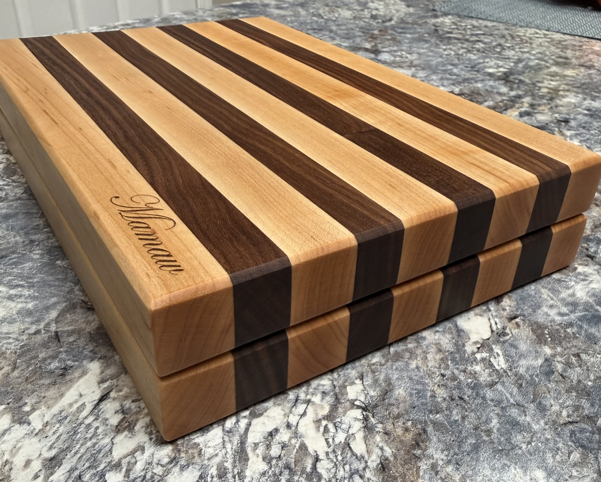
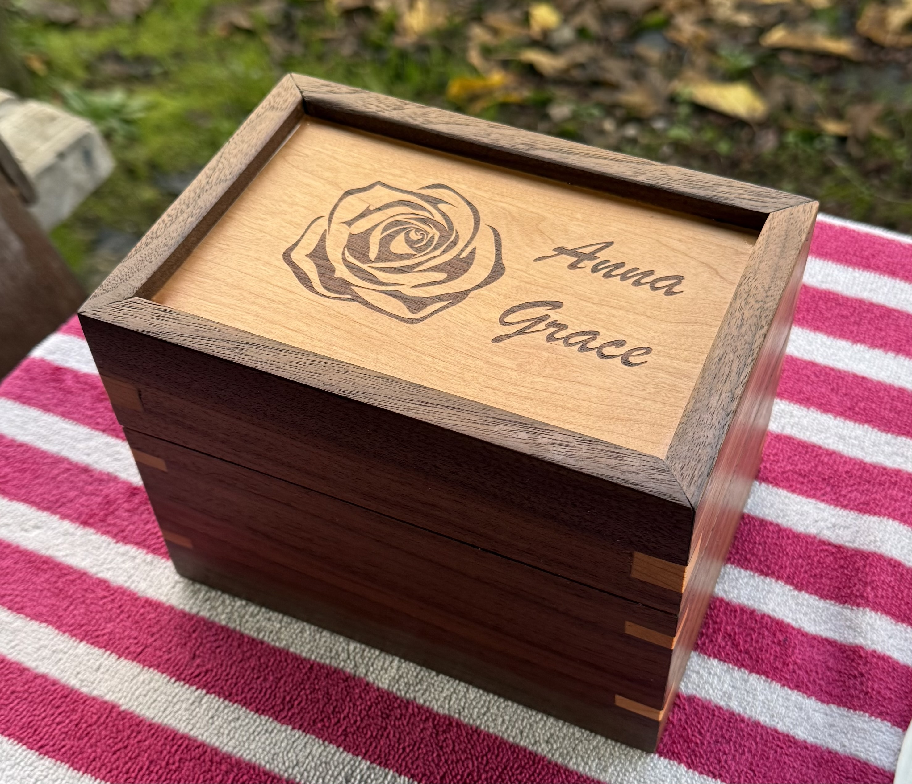
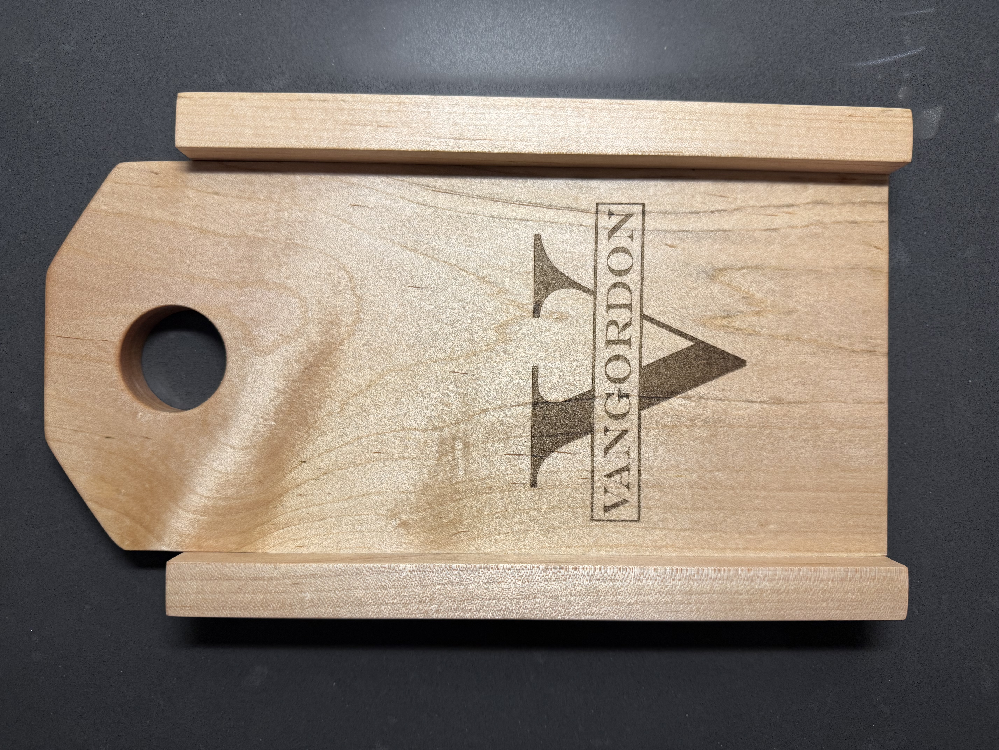
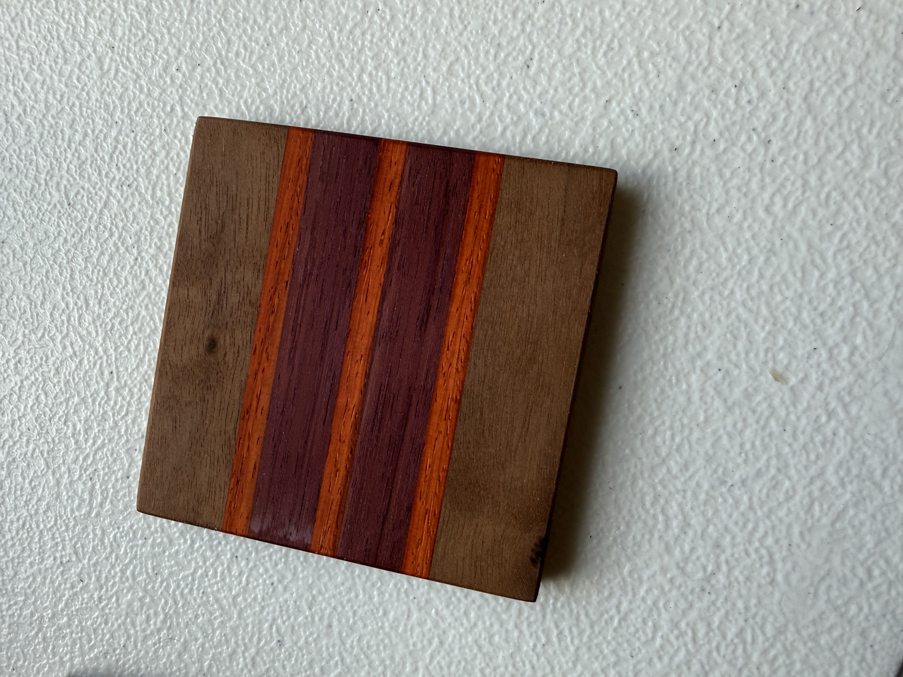
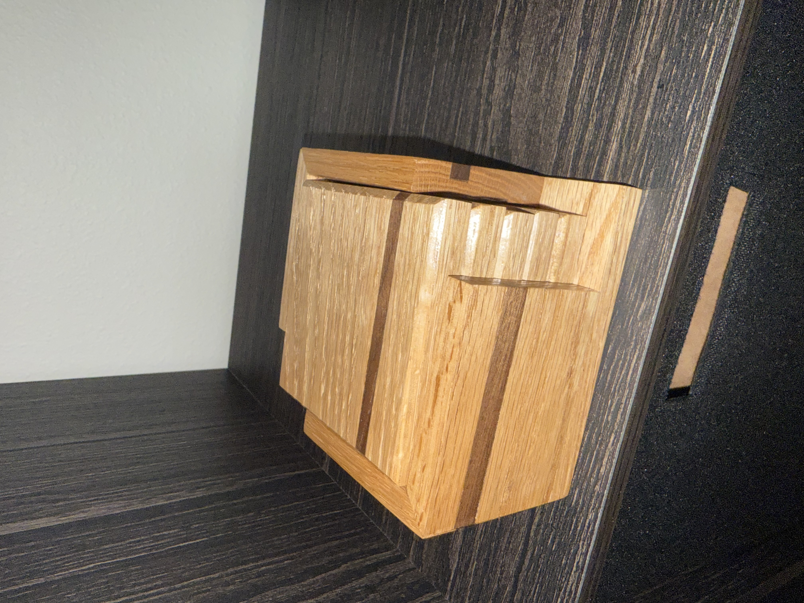

[Home](/) | [About Me](/about) | [My Projects](/projects) | [Publications](/publications)

# About Me

I have been fascinated by the life sciences since childhood, drawn to the 
intricate complexity of living organisms. After earning my B.S. in Biology 
from George Fox University, I entered research and development at Hexion Inc., 
where I built a foundation in data science and learned coding through courses 
at community college and other online resources. Seeking to bridge the gap 
between biology and data, I completed my M.S. in Bioinformatics at the 
University of Oregon’s Knight Campus, sharpening my skills in complex data 
management, programming, and molecular biology.

My graduate work led to a 9-month internship at Oregon Health & Science 
University's (OHSU) Knight Cancer Institute, where I developed machine 
learning methods for single-cell multiomics alongside Dr. Cigdem Ak. Following 
this role, I expanded my collaboration with Dr. Ak while stepping up as the 
Lead Analyst for the Knight Protein Target Identification (KPTI) hub led by 
Dr. Mark Flory at OHSU. In this position, I manage experimental design, build 
analytical workflows for complex datasets, conduct custom analyses, and 
coordinate directly with clients and collaborators. 

While the path to this point demanded hard work and resilience, the reward of 
doing what I love every day and contributing to life-changing science is 
deeply fulfilling!

## Activities

Outside of work I have several hobbies. Some of those hobbies include 
experimenting with single board computers (e.g. raspberry pi) and woodworking.

### Single Board Computer Projects

As someone who is computationally inclined, I have found that my vocational 
skills are a great asset for cool technology projects. Here are a few of the 
projects I have done over the last few years:

- Implemented a DNS server to prevent advertisement and malware queries on 
personal networks
- Used general-purpose input/output pins to yield physical outputs such as LCD 
displays
- Created a customized display that pulls and shows live data from the 
internet, using a public GitHub repository and implementing multiple modules 
from other authors
- Followed several documented workflows to complete projects while 
strengthening Bash and Python skills outside of biological context

### Woodworking

Since I was in high school, I have enjoyed building things out of wood. The 
satisfaction of designing and building something that no one else has is 
extremely fulfilling. Here are a few of the things that I have made!

#### Cutting Boards

These cutting boards are made of black walnut and hard maple using food safe 
Titebond III. 

#### Recipe Box

This recipe box is made of black walnut and cherry with the lid having a 
custom laser engraving.

#### Bread Board

This bread board is made from maple with a custom family laser engraving and 
enables consistent bread slices of sour dough bread!

#### Custom Coasters

I have made many coasters but here are two of my favorite. The left one uses 
black walnut, purple heart, and African paduak. The right is white oak with a 
black walnut inlay.

  
  

